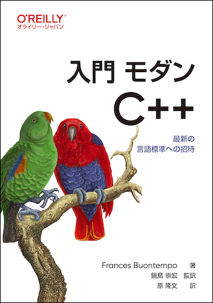

# 入門 モダンC++

---



---

本リポジトリはオライリー・ジャパン発行書籍『[入門 モダンC++](https://www.amazon.co.jp/dp/4814401817)』のサポートサイトです。

## サンプルコード

<!-- 
本書のサンプルコードは原書のリポジトリから取得できます。

> <https://github.com/doctorlove/IntroducingCpp>
 -->

サンプルコードの解説は本書籍をご覧ください。

### 構成

```
.
├── README.md
├── appendix_a           // 付録Aのコード
├── chapter_01           // 1章のコード
├── chapter_02           // 2章のコード
├── chapter_03           // ...
├── chapter_04
├── chapter_05
├── chapter_06
├── chapter_07
├── chapter_08
├── chapter_09
├── chapter_10
├── chapter_11
├── chapter_12
├── chapter_13
├── chapter_14
├── chapter_15
└── introducing-cpp-ja.png
```

### 日本語版付録のサンプルコード

日本語版オリジナルの付録Aで紹介したサンプルコードは本リポジトリから取得できます。

- [付録Aのサンプルコード](./appendix_a/README.md)

<!-- 
#### ライセンス

[GNU GENERAL PUBLIC LICENSE](./appendix_a/LICENSE)
[MIT](./appendix_a/LICENSE)
 -->

<!-- 
## サンプルコード

本書のサンプルコードは原書のリポジトリから取得できます。

> <https://github.com/doctorlove/IntroducingCpp>

サンプルコードの解説は本書籍をご覧ください。

----

## 付録Aのサンプルコード

日本語版オリジナルの付録Aで紹介したサンプルコードは本リポジトリから取得できます。

- [付録Aのサンプルコード](./appendix_a/README.md)

#### ライセンス

[MIT](./appendix-a/LICENSE)

サンプルコードの解説は本書籍をご覧ください。
 -->

----

## 正誤表

本書の正誤情報は以下のページで公開しています。

<https://github.com/oreilly-japan/introducing-cpp-ja/wiki/errata>

本ページに掲載されていない誤植など間違いを見つけた方は、[japan@oreilly.co.jp](<mailto:japan@oreilly.co.jp>)までお知らせください。

